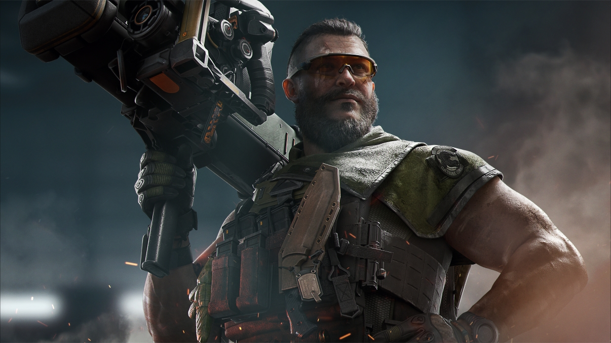
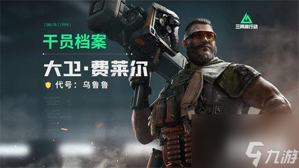
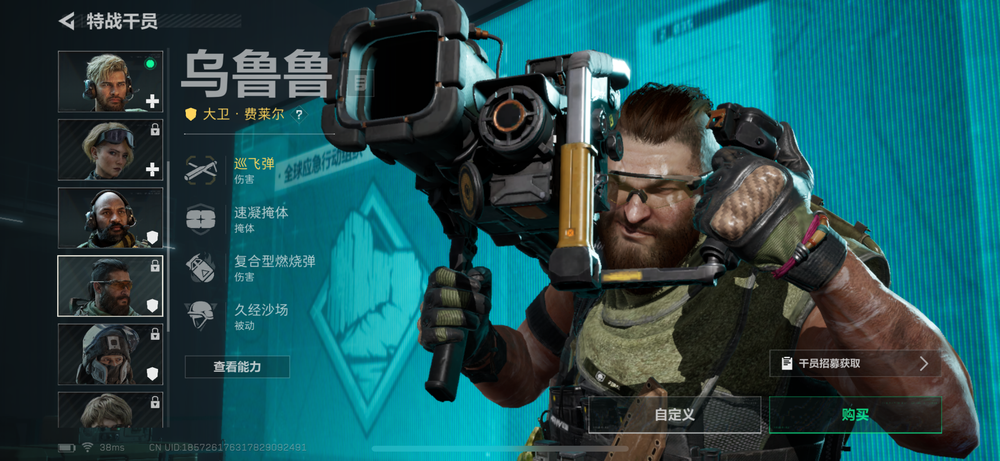

# 🪨 乌鲁鲁牛逼

**《三角洲行动》工程兵干员 · 乌鲁鲁（Uluru）**

> 家人们谁懂啊，工程兵一哥、版本答案、堵桥代言人，YYDS！🚀

*▲ 乌鲁鲁干员立绘 · 侧身扛弹，稳如老狗*

---

## 🎮 游戏介绍：《三角洲行动》

《三角洲行动》（Delta Force）是由 **腾讯天美工作室群 Team Jade** 研发、**Level Infinite** 发行的免费战术射击游戏，主打真实战场、硬核对枪和战术配合，一句话：**真·硬核，尊嘟假嘟都挡不住它的火。**

### 三大核心玩法

| 模式 | 类型 | 精髓 |
| :--- | :--- | :--- |
| 🔥 **烽火地带** | 撤离摸金玩法 | 捡装备一时爽，撤不出去泪两行 |
| ⚔️ **全面战场** | 大规模战场（胜者为王） | 载具、无人机、百人混战，老六出没请注意 |
| 🚁 **黑鹰坠落** | 战役模式 | 致敬经典，爷的青春回来了 |

---

## 🪖 干员介绍：乌鲁鲁（Uluru）

| 档案 | 详情 |
| :--- | :--- |
| 本名 | 大卫·费莱尔（David Feller） |
| 定位 | 工程兵（火力突进 & 防御） |
| 隶属 | G.T.I. 大洋洲分部 |
| 身高 / 体重 | 191 cm / 118 kg |
| 代号由来 | 澳大利亚地标「艾尔斯巨岩」，当地土著称 **乌鲁鲁** 🪨 |

**人设速写**：一个既能给你砌墙挡子弹、又能放飞弹炸载具的男人，真正的 **五边形战士**，泰裤辣！

*▲ 乌鲁鲁站姿 · 工程兵一哥在线砌墙*

---

## 💣 技能一览

### 1. 巡飞弹 🎯
图像制导巡飞弹，**开镜**精确打击 / **腰射**预设制导，爆炸时额外霰射 **4 枚炸弹**，飞行范围 **180 米**。反载具、反防空、堵桥清点，一发入魂。

*▲ 乌鲁鲁瞄准 · 巡飞弹准备就绪，一发入魂*

### 2. 速凝掩体 🧱
投掷快速凝固混凝土，瞬间生成可挡伤害的掩体，支持**横向 / 竖向**切换。家人们，这墙是真能救命，绝绝子。

### 3. 复合型燃烧弹 🔥
触地即炸，持续灼烧，还能**烧毁敌方速凝掩体**，封路、逼走位、排点一条龙。

### 4. 被动 · 久经沙场 🛡️
对**骨折**、**减速**等负面效果抗性拉满，跑得快、站得稳，老六都追不上。

---

## 🏆 为什么说「乌鲁鲁牛逼」

- 🥇 **工程兵一哥**：攻防一体，进可攻退可守。
- 🌉 **堵桥代言人**：巡飞弹堵桥，一辆载具都别想过。
- 📈 **S9 版本答案**：与「老黑」搭档，T0 阵容，遥遥领先！
- 💥 **反载小能手**：巡飞弹 + AT4「双筒」，坦克来了也得绕道。

> **经典连招**：速凝掩体砌墙 → 燃烧弹封锁驱赶 → 巡飞弹精准收割。真香定律：用完都说好。

---

### 🪨 乌鲁鲁牛逼，YYDS！🚀

